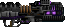
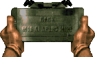
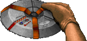

# UZ's Weapons Pack
_Creative, I know_

Requires [HDCoreLib](https://github.com/HDest-Community/hdest-core-lib).

## Black Hole Generator

- Loadout Code: `bhg`
- Hold `[FIRE]` to charge up & fire.
- Press `[RELOAD]` to reload batteries.
- Press `[UNLOAD]` to unload batteries.
- **!CAUTION!** Black Holes fired known to be unstable!

## Claymore Mines

- Loadout Code: `cly`
- Similar to Doorbusters in that they're an inventory item you `[USE]` to place on the ground at the spot you're looking at, facing away from you.  If a hostile walks within the cone, it'll detonate.
- Press `[USE]` near claymore to pick up & deactivate it.
- Can be shot in a pinch.

## Land Mines

- Loadout Code: `min`
- Hold `[FIRE]` to activate & toss.
- Press `[RELOAD]` to deactivate and cancel toss.
- Press `[USE]` near active land mine to **attempt** to kick away.
- Press `[USE]` **while crouching** near active land mine to pick up & deactivate land mine.
- Can be shot in a pinch.  Careful, may get cought in the cross-fire!

## SPAS-12

- Loadout Code: `sps`
  - Loadout Config:
    - `firemode 0/1` Whether to start in semi-auto mode.
    - `rounds #` Specify Shells to load SPAS-12 with:
      - 1 -> Buckshot
      - 2 -> Slugs
      - 3 -> Flechettes
    - 4 -> Explosive Slugs
    - 5 -> Less-Lethal Buckshot
    - 6 -> Flares
- Press `[FIRE]` to fire the round in the chamber.
- Press `[ALTFIRE]` to pump the shotgun.
  - While holding `[ALTFIRE]` and the rack is pumped:
    - Pressing `[RELOAD]` will insert the selected round type directly into the chamber, assuming it's empty.
    - Pressing `[UNLOAD]` will remove the round from the chamber, if there is one.
- Press `[RELOAD]` to grab a few of the selected rounds from your pockets and begin inserting them into the tube.
- Hold `[ALTRELOAD]` and press one of the following:
  - Pressing `[FIRE]` will cycle to the next Shell Type, looping back to the beginning.
  - Pressing `[ALTFIRE]` will cycle to the previous Shell Type, looping back to the end.
  - Pressing `[RELOAD]` will toggle the Tube Disconnect.  When the tube is disconnected, pumping the rack will not feed any round from the tube into the chamber.
  - Pressing `[FIREMODE]` will toggle whether the stock is extended or collapsed.

## Credits

### Black Hole Generator
- Code: Matt, Undead_Zeratul
- Sounds: Raven Software (Quake 4), Epic Games (UT 2004)
  - BH_LOOP: NASA
- Sprites: NMN, Zero Prophet, Reactor, Kronos, Midway, Gothic

### Claymore Mines
- Code: Captain Toenail, Undead_Zeratul
- MODELDEF: Potetobloke
- Sounds: 3D Realms,
  - CLAYARMD: [insanity54](https://freesound.org/people/insanity54/sounds/349662/)
- Sprites: Id Software, TNTTeam, Captain Toenail

### Land Mines
- Code: Gothic, Undead_Zeratul
- Sounds: LucasArts (Dark Forces), id Software (Quake 2)
- Sprites: LucasArts (Dark Forces), Gothic

### SPAS-12
- Code: Matt, Undead_Zeratul
- Sounds: TBD
- Sprites: Wocht11K, MG0061, TommyGalano5 (Reference), Craneo (Reference), Sonik.O (Muzzle Flash)
