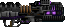
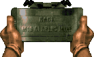
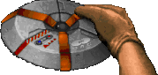

# UZ's Weapons Pack
_Creative, I know_

Requires [HDCoreLib](https://github.com/HDest-Community/hdest-core-lib).

## Black Hole Generator

- Loadout Code: `bhg`
- Hold `[FIRE]` to charge up & fire.
- Press `[RELOAD]` to reload batteries.
- Press `[UNLOAD]` to unload batteries.
- **!CAUTION!** Black Holes fired known to be unstable!

## Claymore Mines

- Loadout Code: `cly`
- Similar to Doorbusters in that they're an inventory item you `[USE]` to place on the ground at the spot you're looking at, facing away from you.  If a hostile walks within the cone, it'll detonate.
- Press `[USE]` near claymore to pick up & deactivate it.
- Can be shot in a pinch.

## Land Mines

- Loadout Code: `min`
- Hold `[FIRE]` to activate & toss.
- Press `[RELOAD]` to deactivate and cancel toss.
- Press `[USE]` near active land mine to **attempt** to kick away.
- Press `[USE]` **while crouching** near active land mine to pick up & deactivate land mine.
- Can be shot in a pinch.  Careful, may get cought in the cross-fire!

## Credits

### Black Hole Generator
- Code: Matt, Undead_Zeratul
- Sounds: Raven Software (Quake 4), Epic Games (UT 2004)
  - BH_LOOP: NASA
- Sprites: NMN, Zero Prophet, Reactor, Kronos, Midway, Gothic

### Claymore Mines
- Code: Captain Toenail, Undead_Zeratul
- MODELDEF: Potetobloke
- Sounds: 3D Realms,
  - CLAYARMD: [insanity54](https://freesound.org/people/insanity54/sounds/349662/)
- Sprites: Id Software, TNTTeam, Captain Toenail

### Land Mines
- Code: Gothic, Undead_Zeratul
- Sounds: LucasArts (Dark Forces), id Software (Quake 2)
- Sprites: LucasArts (Dark Forces), Gothic
